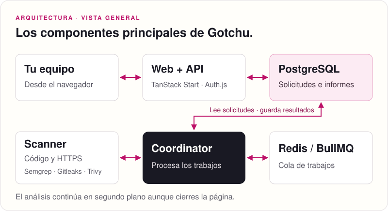

<p align="center">
  <picture>
    <source media="(prefers-color-scheme: dark)" srcset="docs/assets/logo-dark.svg">
    
  </picture>
</p>

<p align="center">
  Seguridad de aplicaciones, con evidencia y correcciones revisables.
</p>

<p align="center">
  <a href="https://gotchu.kevinbravo.com">Aplicación</a> ·
  <a href="#cómo-funciona">Cómo funciona</a> ·
  <a href="#arquitectura">Arquitectura</a> ·
  <a href="#ejecutar-en-tu-máquina">Instalación local</a> ·
  <a href="#documentación">Documentación</a>
</p>

---

Gotchu analiza el código y la web de tu aplicación para detectar riesgos de seguridad. Reúne los hallazgos en un informe que explica qué encontró, dónde está la evidencia y cómo corregirlo. Puedes revisar solo el código, solo una web HTTPS o ambos, y programar nuevas evaluaciones para seguir los cambios.

## Qué puedes hacer

| Función | Cómo funciona y qué obtienes |
|---|---|
| Revisar código y configuración | Sube una carpeta o conecta GitHub. Gotchu busca patrones de riesgo, posibles secretos y problemas de configuración en Kubernetes, Terraform y Dockerfiles. |
| Analizar dependencias | Contrasta las dependencias de proyectos npm, pnpm y Yarn con avisos de vulnerabilidad. Consulta las licencias declaradas y descarga un inventario de componentes (SBOM) en formato CycloneDX. |
| Evaluar una web o API | Indica un origen HTTPS público autorizado. Gotchu comprueba TLS, cabeceras y rutas públicas mediante perfiles HTTP/API acotados, sin necesitar el código fuente. |
| Consultar informes | Abre la evidencia de cada hallazgo, su severidad, confianza y recomendación. Exporta el informe en JSON o copia un prompt con el contexto para tu asistente de código. |
| Preparar correcciones | Genera cambios compatibles en una copia privada y revisa el diff, el reanálisis y la validación configurada. Con los requisitos cumplidos y la aprobación del cambio exacto por el Owner, publica un PR en borrador. |
| Vigilar cambios | Programa revisiones de código, dependencias y HTTPS. Recibe alertas por email o webhooks firmados mediante los canales configurados. |
| Recibir eventos de tu aplicación | Integra eventos firmados o el SDK de Node para agrupar errores y señales sospechosas en alertas e incidentes con contexto. |
| Trabajar en equipo | Organiza proyectos en espacios de trabajo, invita personas y asigna roles Owner, Operator o Viewer. Consulta el historial de decisiones y configura la retención de datos. |

La IA es opcional: permite investigar hallazgos y proponer correcciones con el modelo que configures y los datos que autorices. El análisis de código y HTTPS funciona sin un modelo. Las notificaciones y la publicación de PR requieren sus integraciones habilitadas.

## Cómo funciona

<p align="center">
  
</p>

1. Crea un espacio de trabajo y añade tu aplicación con una carpeta, un repositorio o una web HTTPS que tengas autorización para evaluar.
2. Elige qué revisar e inicia el análisis. Gotchu trabaja en segundo plano y muestra el progreso hasta guardar el informe.
3. Revisa los hallazgos y sus recomendaciones. Puedes copiar el contexto a tu asistente, preparar una corrección compatible o activar la vigilancia.

## Qué recibes al terminar

Un informe por evaluación, con los hallazgos, sus ubicaciones y la evidencia que los respalda. La severidad describe el impacto potencial; la confianza indica qué sostiene la evidencia; la explotabilidad se muestra por separado. El informe también identifica las comprobaciones realizadas y la cobertura que queda desconocida.

<p align="center">
  
</p>

Para corregir desde Gotchu, el flujo es: candidato privado → revisión del diff y reanálisis → validación configurada → aprobación exacta del Owner → PR en borrador. También puedes usar el informe y el prompt para hacer el cambio en tu propio flujo de desarrollo.

El análisis estático no instala dependencias ni ejecuta tu aplicación. La validación de correcciones usa un entorno separado que debe estar configurado. Cada resultado se limita a lo comprobado: una dependencia vulnerable es un indicio de riesgo y una evaluación sin hallazgos no garantiza seguridad.

## Arquitectura

La web gestiona las sesiones y los permisos. PostgreSQL conserva las solicitudes y los informes; el coordinator procesa los trabajos en segundo plano con una cola Redis/BullMQ y llama al scanner para realizar las evaluaciones.

<p align="center">
  
</p>

La investigación con IA, la validación de correcciones y la publicación de PR usan servicios separados y opcionales. Los componentes y sus contratos están descritos en la [guía de arquitectura](docs/architecture.md).

## Ejecutar en tu máquina

Necesitas Linux x86_64, Docker Engine con Compose v2, Node.js 24, pnpm 11 y OpenSSL. Reserva al menos 5 GiB libres en el almacenamiento de Docker.

```sh
git clone https://github.com/0bkevin/gotchu.git
cd gotchu
./gotchu up
```

El comando prepara los servicios locales e imprime un enlace de configuración de un solo uso. Ábrelo para crear tu cuenta Owner y el primer espacio de trabajo. Después, añade una aplicación e inicia su primera evaluación.

La instalación escucha en localhost. Consulta [self-hosting](docs/self-hosting.md) para los requisitos completos, las integraciones y el acceso mediante HTTPS.

Para desarrollar en el repositorio, con los mismos requisitos:

```sh
pnpm install --frozen-lockfile
pnpm dev:prepare
pnpm dev:start
```

Abre http://localhost:3000/dashboard y crea una cuenta. `pnpm dev:stop` detiene las aplicaciones y conserva los datos. Los puertos, logs y comandos de comprobación están en [desarrollo local](docs/development.md).

## Documentación

| Guía | Contenido |
|---|---|
| [Self-hosting](docs/self-hosting.md) | Instalación, GitHub, modelos de IA y respaldos. |
| [Desarrollo local](docs/development.md) | Entorno de desarrollo y comprobaciones. |
| [Operaciones](docs/operations.md) | Vigilancia, notificaciones, eventos y correcciones. |
| [Arquitectura](docs/architecture.md) | Componentes, contratos y límites entre servicios. |
| [Estado de implementación](docs/implementation-plan.md) | Capacidades implementadas, condiciones y evidencia de validación. |
| [Roadmap](docs/roadmap.md) | Próximas funciones y verificaciones pendientes. |
