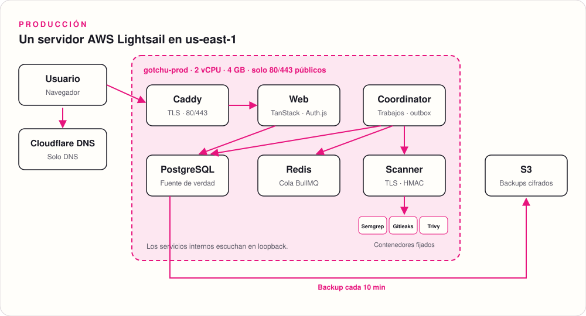
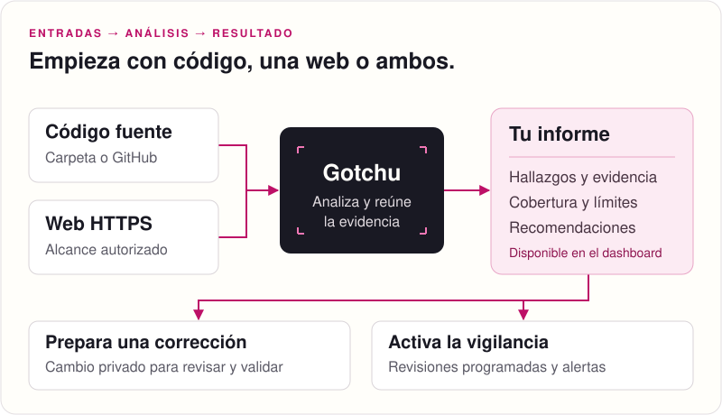
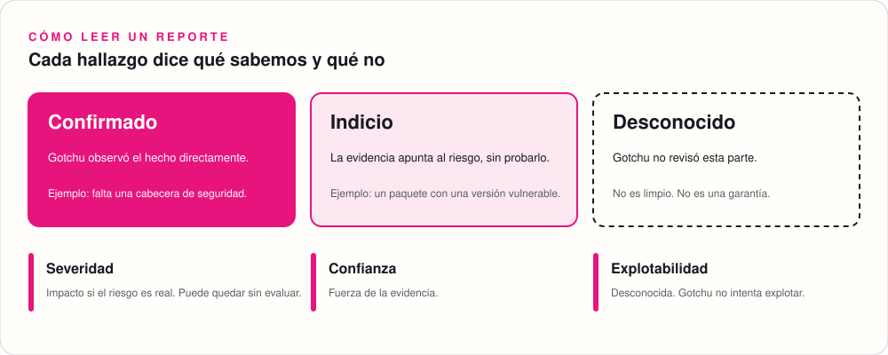

<p align="center">
  <picture>
    <source media="(prefers-color-scheme: dark)" srcset="docs/assets/logo-dark.svg">
    
  </picture>
</p>

<p align="center">
  <strong>Revisa el código de tu app, tu web o ambos. Cada hallazgo trae su evidencia.</strong>
</p>

<p align="center">
  <a href="https://gotchu.kevinbravo.com">App</a> ·
  <a href="#ejecutar-en-tu-máquina">Ejecutar</a> ·
  <a href="docs/self-hosting.md">Self-hosting</a> ·
  <a href="docs/architecture.md">Arquitectura</a> ·
  <a href="docs/implementation-plan.md">Estado</a> ·
  <a href="docs/validation.md">Verificación</a>
</p>

<p align="center">
  
  
  
  
  <a href="https://gotchu.kevinbravo.com"></a>
</p>

---

> **¿Qué riesgos tiene mi aplicación, qué prueba cada uno y qué hago después?**

Gotchu responde a esa pregunta. Revisa el código fuente, el origen HTTPS o los dos. Después, te da un reporte con evidencia y te ayuda a preparar correcciones.

- **Tú eliges.** Revisa solo el código, solo la web o ambos. La revisión externa no necesita tu código.
- **Muestra la evidencia.** Cada hallazgo enlaza su evidencia, su severidad y su confianza.
- **No oculta lo que no revisó.** Una cobertura parcial queda como desconocida, no como limpia.
- **No ejecuta tu código.** Gotchu no instala paquetes, no ejecuta scripts y no intenta explotar nada.

## En vivo

| | |
|---|---|
| Aplicación | https://gotchu.kevinbravo.com |
| Infraestructura | AWS Lightsail en `us-east-1`, con TLS en Caddy y backups cifrados en S3 |

Abre `/dashboard` y elige **Crear una cuenta**. Cada cuenta nueva crea su propio espacio de trabajo aislado. El runbook de producción está en [infra/aws](infra/aws/README.md).

<p align="center">
  
</p>

## Cómo funciona

<p align="center">
  
</p>

| Paso | Qué hace Gotchu |
|---|---|
| 1. Espacio de trabajo | Crea un espacio privado. El creador es su Owner. Los roles controlan el acceso. |
| 2. Código fuente | Sube una instantánea o conecta un repositorio Git o GitHub autorizado. Gotchu guarda el commit exacto. |
| 3. Origen HTTPS | Publica un registro TXT en `_gotchu.<hostname>`. Gotchu verifica el control DNS antes de consultar el origen. |
| 4. Evaluación | Ejecuta una evaluación `internal`, `external` o de los dos tipos. |
| 5. Reporte | Muestra la evidencia, la cobertura, la severidad, la confianza y las limitaciones. |
| 6. Corrección | Prepara correcciones compatibles en una instantánea privada y pide una nueva evaluación. |

## Qué puedes hacer

| Función | Descripción |
|---|---|
| Espacios de trabajo | Roles Owner, Operator y Viewer. Los Viewer solo pueden leer. |
| Revisión del código | Inventario de versiones exactas de npm, pnpm y Yarn. Política de licencias declaradas. SBOM CycloneDX 1.5 para descargar. |
| Revisión externa | Con el perfil raíz, una sola petición GET a `/`. Con el consentimiento `public_surface`, hasta diez peticiones GET al mismo origen. |
| Vigilancia | Revisiones programadas del código y del origen. Alertas por cambios del repositorio y por nuevos avisos de npm. |
| Eventos firmados | Agrupa errores, presión del servicio y actividad sospechosa compatible en alertas. |
| Historial de decisiones | Muestra quién hizo cada acción, cuándo y con qué resultado. No muestra credenciales ni direcciones IP. |
| Correcciones | Recetas versionadas para hallazgos de Semgrep (TLS desactivado) y de Trivy (KSV001, KSV012, KSV014, KSV017). Los otros hallazgos solo reciben guía. |

## Qué no afirma Gotchu

<p align="center">
  
</p>

- Una coincidencia no prueba que el código esté desplegado.
- Un paquete vulnerable no prueba que el código vulnerable se pueda alcanzar.
- Un pico de tráfico no prueba un ataque.
- "Sin hallazgos" no es una garantía de seguridad. Solo describe lo que la evaluación revisó.
- La severidad de un incidente no da más permisos de acción.

## Ejecutar en tu máquina

Necesitas Docker iniciado, Node 24 y pnpm 11.

```sh
git clone https://github.com/0bkevin/gotchu.git
cd gotchu
./gotchu up
```

1. Abre el enlace de configuración. El comando lo imprime y solo funciona una vez.
2. Crea el Owner y el primer espacio de trabajo.
3. Sube una carpeta de código desde el dashboard.
4. Inicia una evaluación `internal`.

El runtime escucha solo en loopback. No expongas el puerto sin `GOTCHU_PUBLIC_URL` con HTTPS y un proxy TLS. Los requisitos y los componentes opcionales están en [self-hosting](docs/self-hosting.md).

## Desarrollo local

```sh
pnpm install --frozen-lockfile
pnpm dev:prepare   # solo si faltan las imágenes fijadas
pnpm dev:start
```

Abre http://localhost:3000/dashboard. En desarrollo, el registro local está activo. No hay cuentas, espacios ni datos de demostración precargados.

| Servicio | Puerto | Variable para cambiarlo |
|---|---|---|
| Web | 3000 | `GOTCHU_DEV_WEB_PORT` |
| Coordinator | 3003 | `GOTCHU_DEV_COORDINATOR_PORT` |
| Scanner | 4400 | `GOTCHU_DEV_SCANNER_PORT` |

Postgres y Redis usan volúmenes locales persistentes. El launcher guarda los PID, los puertos, los logs y las credenciales locales del scanner en `.local/dev`. `pnpm dev:stop` detiene las apps y deja Postgres, Redis y sus datos activos. Más detalles en [desarrollo local](docs/development.md).

<details>
<summary><strong>Conectar una GitHub App en desarrollo</strong></summary>

1. Crea una GitHub App con estos permisos de repositorio: **Contents: read-only**, **Checks: read-only** y **Pull requests: read-only**.
2. Deja los webhooks desactivados, salvo que los configures aparte.
3. Usa esta Callback URL: `http://localhost:3000/api/customer/github/callback`.
4. Activa **Request user authorization (OAuth) during installation**.
5. Guarda las credenciales en un archivo JSON con `id`, `clientId`, `clientSecret`, `privateKeyPem` y `webhookSecret`. Agrega `slug` o define `GOTCHU_GITHUB_APP_SLUG`.
6. Define `GOTCHU_GITHUB_READER_APP_FILE` con la ruta de ese archivo.
7. Instala la App solo en repositorios que tienes autorización para evaluar.

No envíes ese archivo al navegador y no lo agregues a Git. Gotchu crea los tokens de instalación en el servidor y los guarda solo en memoria.

Para mover una instalación a otro espacio de trabajo, desconéctala primero del espacio actual. Después, un Owner del espacio de destino autoriza la conexión. Solo un espacio puede tener la instalación activa.

</details>

## Estado y límites

| Área | Estado |
|---|---|
| Producción | Desplegado en AWS: un servidor Lightsail de 4 GB en `us-east-1`. Web, coordinator y scanner corren como servicios systemd. Solo los puertos 80 y 443 son públicos. |
| Registro | Público en producción. Cada cuenta nueva no tiene acceso a los espacios existentes. |
| Backups | Cada diez minutos, cifrados y enviados a S3. Una restauración en una base de datos desechable funcionó. |
| Scanner | Semgrep, Gitleaks y Trivy fijados. Probado en vivo con casos sintéticos. |
| Abierto | Un solo servidor sin failover. Falta medir la capacidad con usuarios reales y la recuperación completa en un servidor limpio. |
| Desactivado | Ejecución del código del cliente, escrituras en proveedores y acciones de respuesta automáticas. |
| Identidad | Correo y contraseña con Auth.js, WebAuthn step-up e invitaciones por espacio. El correo no está verificado. No hay inicio de sesión externo configurado. |

Las pruebas de integración del flujo del cliente están en `test/integration/customer-applications.test.ts`. La ruta TLS de producción del scanner está en `test/integration/production-scanner.test.ts`. El [registro de verificación](docs/validation.md) describe el alcance y los límites de cada prueba.

Las aplicaciones ficticias vulnerables y corregidas son fixtures de regresión. No son el producto y no limitan las evaluaciones de los clientes.

## Documentación

| Documento | Contenido |
|---|---|
| [Arquitectura](docs/architecture.md) · [Vista general](docs/architecture-overview.html) | Componentes y contratos |
| [Plan de implementación](docs/implementation-plan.md) | Estado y release gates |
| [Operaciones](docs/operations.md) | Monitoreo, alertas y correcciones |
| [Self-hosting](docs/self-hosting.md) | Instalación en tu propia máquina |
| [Entrevista de definición](docs/definition-interview.md#current-user-correction-actual-customer-application-in-development) | Decisiones de producto |
| [Plan de defensa autónoma](docs/plan-defensa-autonoma.md) | Hoja de ruta. No es una lista de funciones disponibles. |
